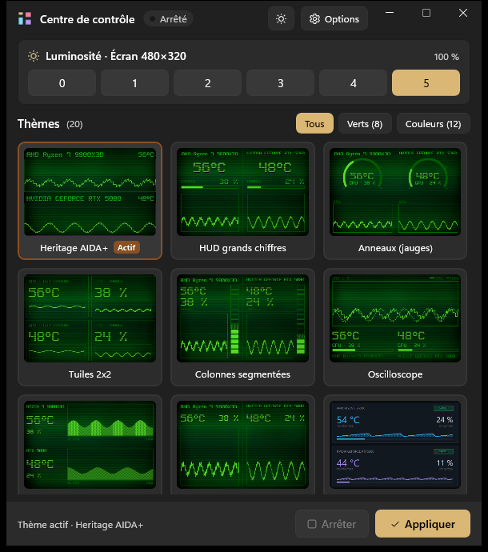

# Centre de contrôle

Application Windows 11 (**WinUI 3 / .NET 10**) qui pilote le panneau capteurs **480×320** (`Moniteur.exe`).
Le centre s’affiche sur l’écran principal avec la DA native de Windows 11 (Mica, thème Clair/Sombre, cartes Fluent). Le moniteur reste sur le petit écran 480×320.

Aucun prérequis à installer sur un PC Windows 11 vierge (ni Python, ni .NET, ni Windows App Runtime).



## Installation (PC vierge)

Télécharger et lancer **`CentreControle-Setup-2.0.0.exe`** depuis les [Releases GitHub](https://github.com/yoyo1306/Centre/releases) :

- Installe `CentreControle.exe` et `Moniteur.exe` dans `C:\Program Files\Centre de contrôle` (runtime `.NET 10` et `WinUI 3` embarqués et partagés).
- Installe automatiquement la police `Dash Digital-7` (`assets\dash-digital.ttf`).
- Installe silencieusement le pilote capteurs CPU **PawnIO** (`libs\PawnIO_setup.exe`, GPLv2 via pawnio.eu) s’il n’est pas encore présent sur le PC.
- Option de démarrage automatique du Moniteur (`SensorPanel` en administrateur) directement proposée par l’installateur.
- Désinstallation propre depuis **Paramètres Windows → Applications**.

Les réglages (`config.ini`, `centre.ini`) sont stockés dans `%ProgramData%\CentreControle\` lorsqu’installé dans `Program Files`, ou dans le dossier local en mode portable.

## Utilisation

| Action | Effet |
|---|---|
| Clic sur une vignette (au relâchement) | Sélectionne et prévisualise le thème instantanément sur le moniteur (via Named Pipe). `config.ini` n’est pas modifié. |
| Filtres `Tous` / `Verts (8)` / `Couleurs (12)` | Filtre la grille des 20 thèmes. |
| Appliquer | Enregistre le thème dans `config.ini` et joue le son en deux temps (`click_down.wav` à l’appui, `click_up.wav` au relâchement). |
| Fermer le centre | Remet le dernier thème enregistré si une prévisualisation était en cours. |
| Arrêter | Arrête proprement `Moniteur.exe`. |
| Icône Soleil / Lune | Bascule Clair / Sombre (mémorisé dans `centre.ini`). |
| 0 à 5 | Règle la luminosité de l’écran 480×320 (DDC/CI). |
| Options | Ouvre le tiroir style Paramètres Windows 11 : démarrage Windows (`SensorPanel`), vitesse de mise à jour (`0,5 s` / `1 s` / `4 s` / `Pause`), recentrage, verrouillage, premier plan du moniteur et état du pilote `PawnIO`. |
| Flèches / Entrée / Échap | Naviguent dans les thèmes, appliquent ou ferment Options. |

## Luminosité (écran 480×320)

Les boutons `0` à `5` règlent uniquement l’écran 480×320 (`0 %`, `20 %`, `40 %`, `60 %`, `80 %`, `100 %`) via `dxva2.dll` (DDC/CI). Un réglage avec le bouton physique de l’écran met à jour l’indicateur en moins de deux secondes. L’écran principal n’est pas modifié.

## Thèmes

Vingt thèmes embarqués en natif C# (rendu GDI+ anti-aliasé double-buffered) :

| Clé | Nom |
|---|---|
| 01-aida | Heritage AIDA+ |
| 02-hud | HUD grands chiffres |
| 03-anneaux | Anneaux (jauges) |
| 04-tuiles | Tuiles 2x2 |
| 05-colonnes | Colonnes segmentées |
| 06-oscillo | Oscilloscope |
| 08-frise | Frise thermique |
| 09-split | Compact splitscreen |
| 10-modern | Modern Dark |
| 11-ambre | Terminal Ambre |
| 12-minimal | Minimal Mono |
| 13-neon | Cyber Néon |
| 14-flux | Flux système |
| 15-atelier | Atelier |
| 16-thermo | Thermo |
| 17-heatmap | Heatmap |
| 18-spectrum | Spectre |
| 19-aiguilles | Aiguilles |
| 20-analytics | Analytics |
| 21-focus | Focus |

## Architecture des sources

```
centre de controle\
    src\
        CentreControle.slnx             solution .NET 10
        CentreControle.Core\            config INI, catalogue thèmes, DDC/CI, Named Pipe IPC, schtasks, PawnIO
        CentreControle.App\             interface WinUI 3 (CentreControle.exe)
        CentreControle.Monitor\         moniteur 480×320 natif (Moniteur.exe, LHM direct, NVML, 20 thèmes)
    installer\
        CentreControle.iss              script Inno Setup 6 (CentreControle-Setup-2.0.0.exe)
    build.ps1                           publie les 2 exe self-contained et compile l’installateur
    assets\                             Fond.png, click_down.wav, click_up.wav, dash-digital.ttf
    libs\PawnIO_setup.exe               installeur officiel PawnIO (GPLv2, pawnio.eu)
    themes\                             vignettes 480×320
    ico.ico                             icône
    legacy\                             archive des anciens scripts Python (v1.x)
    CHANGELOG.md                        historique des versions
```

## Recompiler

Prérequis de développement : **SDK .NET 10** (`win-x64`) et **Inno Setup 6** (`winget install JRSoftware.InnoSetup`).

```powershell
powershell -ExecutionPolicy Bypass -File .\build.ps1
```

Le script publie `CentreControle.exe` (WinUI 3 self-contained) et `Moniteur.exe` (.NET 10 self-contained partagé) dans `publish\`, copie les ressources, puis génère l’installateur `dist\CentreControle-Setup-2.0.0.exe`.
