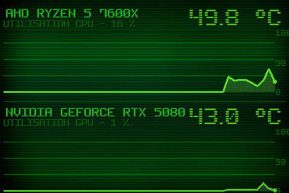

# Theme 01-aida

Classe : `T01AidaPlus` (dans sensor_panel.py)

01 · Heritage AIDA+ : layout AIDA d'origine + grille, aire remplie, point live et echelle.

## Apercu

## Basculer

config.ini : `theme = 1` — ou a la volee : `apply_theme("01-aida")`

    python sensor_panel.py --theme=01-aida
