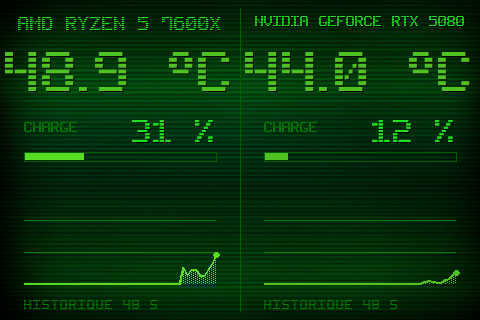

# Theme 02-hud

Classe : `T02Hud` (dans sensor_panel.py)

02 · HUD grands chiffres : deux moities, temperature enorme, barre de charge et sparkline.

## Apercu

## Basculer

config.ini : `theme = 2` — ou a la volee : `apply_theme("02-hud")`

    python sensor_panel.py --theme=02-hud
