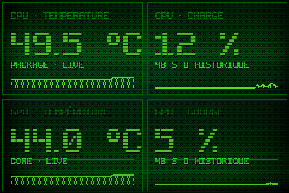

# Theme 04-tuiles

Classe : `T04Tuiles` (dans sensor_panel.py)

04 · Tuiles 2x2 : temp/charge CPU a gauche, temp/charge GPU a droite, mini-historiques.

## Apercu

## Basculer

config.ini : `theme = 4` — ou a la volee : `apply_theme("04-tuiles")`

    python sensor_panel.py --theme=04-tuiles
