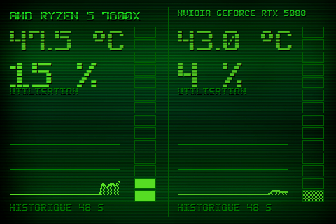

# Theme 05-colonnes

Classe : `T05Colonnes` (dans sensor_panel.py)

05 · Colonnes segmentees : gros chiffres + colonne VU-metre 14 crans par moitie.

## Apercu

## Basculer

config.ini : `theme = 5` — ou a la volee : `apply_theme("05-colonnes")`

    python sensor_panel.py --theme=05-colonnes
