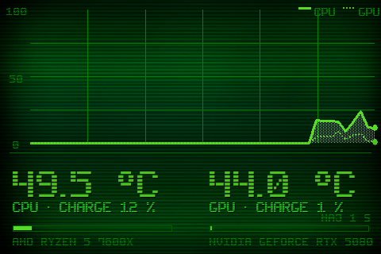

# Theme 06-oscillo

Classe : `T06Oscillo` (dans sensor_panel.py)

06 · Oscilloscope : grande courbe 48 s, CPU plein + GPU en tirets, bandeau de lecture.

## Apercu

## Basculer

config.ini : `theme = 6` — ou a la volee : `apply_theme("06-oscillo")`

    python sensor_panel.py --theme=06-oscillo
