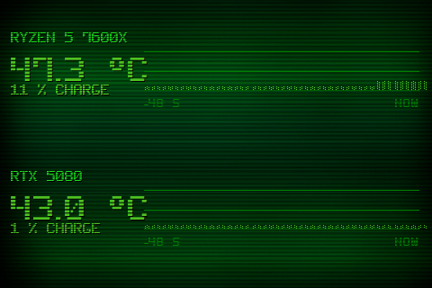

# Theme 08-frise

Classe : `T08Frise` (dans sensor_panel.py)

08 · Frise thermique : 1 barre = 1 s, hauteur + densite = temperature (48 s d'historique).

## Apercu

## Basculer

config.ini : `theme = 8` — ou a la volee : `apply_theme("08-frise")`

    python sensor_panel.py --theme=08-frise
