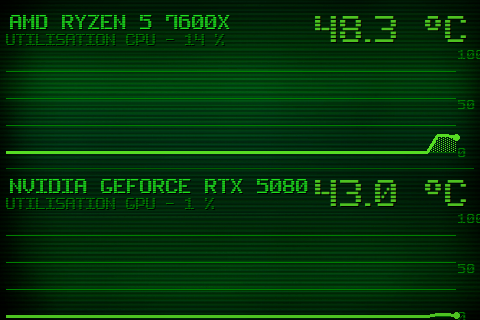

# Theme 01-aida

Classe : `T01AidaPlus` (dans sensor_panel.py)

01 · Heritage AIDA+ : layout AIDA, + grille, aire, point live, echelle.

## Apercu

## Basculer

Clic droit sur le panel > Theme > 01-aida

    python sensor_panel.py --theme=01-aida
