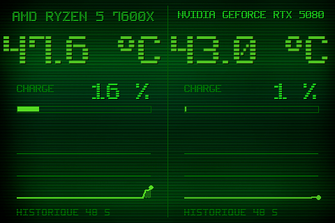

# Theme 02-hud

Classe : `T02Hud` (dans sensor_panel.py)

02 · HUD : deux moities, temp enorme, barre de charge, sparkline.

## Apercu

## Basculer

Clic droit sur le panel > Theme > 02-hud

    python sensor_panel.py --theme=02-hud
