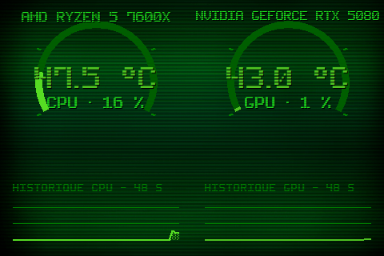

# Theme 03-anneaux

Classe : `T03Anneaux` (dans sensor_panel.py)

03 · Anneaux : jauges circulaires 240°, temp au centre, sparklines en bas.

## Apercu

## Basculer

Clic droit sur le panel > Theme > 03-anneaux

    python sensor_panel.py --theme=03-anneaux
