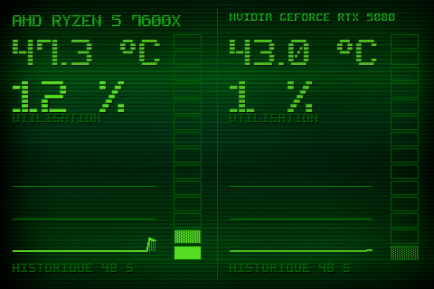

# Theme 05-colonnes

Classe : `T05Colonnes` (dans sensor_panel.py)

05 · Colonnes segmentees : gros chiffres + VU-metre vertical (14 segments).

## Apercu

## Basculer

Clic droit sur le panel > Theme > 05-colonnes

    python sensor_panel.py --theme=05-colonnes
