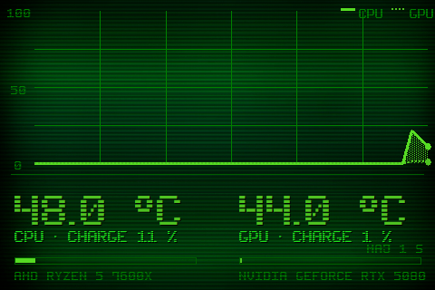

# Theme 06-oscillo

Classe : `T06Oscillo` (dans sensor_panel.py)

06 · Oscilloscope : une grande courbe, CPU plein + GPU en tirets, bandeau de lecture.

## Apercu

## Basculer

Clic droit sur le panel > Theme > 06-oscillo

    python sensor_panel.py --theme=06-oscillo
