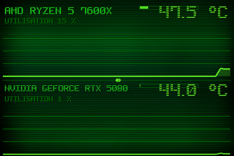

# Theme 07-double

Classe : `T07DoublePeak` (dans sensor_panel.py)

07 · Double peak : 2 courbes empilees + barres de charge dans les entetes.

## Apercu

## Basculer

Clic droit sur le panel > Theme > 07-double

    python sensor_panel.py --theme=07-double
