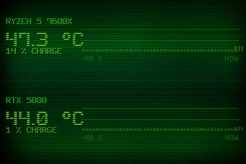

# Theme 08-frise

Classe : `T08Frise` (dans sensor_panel.py)

08 · Frise thermique : barres verticales (1 s = 1 barre), hauteur + densite = temp.

## Apercu

## Basculer

Clic droit sur le panel > Theme > 08-frise

    python sensor_panel.py --theme=08-frise
