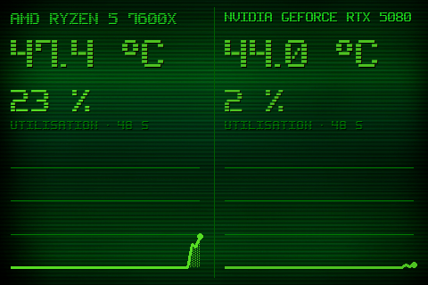

# Theme 09-split

Classe : `T09Split` (dans sensor_panel.py)

09 · Compact splitscreen : CPU a gauche, GPU a droite, courbes independantes.

## Apercu

## Basculer

Clic droit sur le panel > Theme > 09-split

    python sensor_panel.py --theme=09-split
